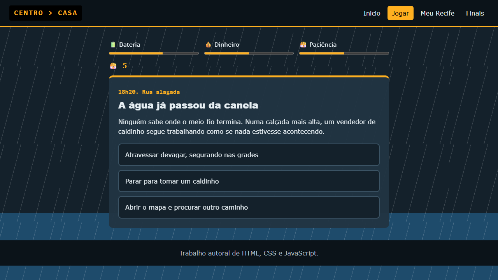

<div align="center">

# 🌧️ Chove no Recife

**Choveu. E agora, como é que tu chega em casa?**

Um jogo de decisões no navegador, ambientado em um dia de chuva forte no Recife.


</div>

## 🚌 Sobre o jogo

São 17h na Avenida Conde da Boa Vista. O céu fechou, a maré está subindo e tu precisa sair do Centro e chegar em casa. Cada decisão muda o rumo da história e pode te levar para casa ou te deixar no meio do alagamento.

Cuida destas três barras, porque se qualquer uma zerar, tu não chega:

| Barra | Por que importa |
| --- | --- |
| 🔋 **Bateria** | Sem celular, não dá para chamar carro, avisar ninguém nem ver o mapa |
| 💰 **Dinheiro** | Passagem, sombrinha e caldinho custam, e a carteira não é infinita |
| 😤 **Paciência** | Parada lotada e amigo dizendo "tô chegando" acabam com ela rapidinho |

São **12 cenas** e **7 finais** para descobrir.



## ▶️ Como jogar

Não precisa instalar nada nem rodar um servidor:

1. Baixe o projeto pelo botão **Code > Download ZIP** e extraia os arquivos.
2. Dê dois cliques no arquivo `index.html`.
3. Clique em **Tentar chegar em casa** e boa sorte, visse?

## 🗺️ Páginas

| Página | O que tem |
| --- | --- |
| **Início** | A apresentação do jogo e as regras |
| **Jogar** | A história, as decisões e as barras, com a água subindo a cada escolha |
| **Meu Recife** | Informações sobre a cidade e fotos de Boa Viagem, Olinda e do Marco Zero |
| **Finais** | Os finais descobertos, salvos no navegador |

## 🛠️ Como foi feito

O site usa apenas **HTML, CSS e JavaScript**, sem bibliotecas.

- A chuva é uma animação feita só com CSS, usando `@keyframes`.
- A história fica em uma lista de dados, separada das regras do jogo.
- Os finais descobertos ficam guardados no `localStorage` do navegador.
- O layout se adapta ao celular.

```text
chove-no-recife/
├── index.html        página inicial
├── jogar.html        página do jogo
├── meu-recife.html   informações e fotos da cidade
├── finais.html       finais descobertos
├── css/style.css     visual de todas as páginas
├── js/cenas.js       a história: textos e escolhas
├── js/jogo.js        as regras do jogo
├── js/finais.js      monta a página de finais
└── img/              fotos e imagens
```

## 📸 Créditos

Fotos da página Meu Recife: **João Agostinho, eu mesmo**.
